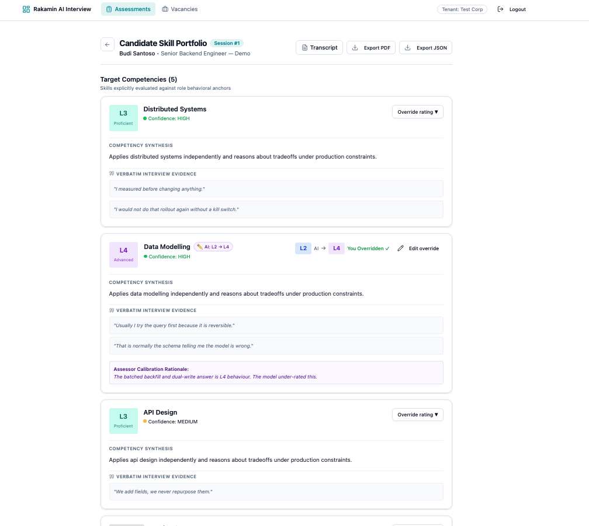
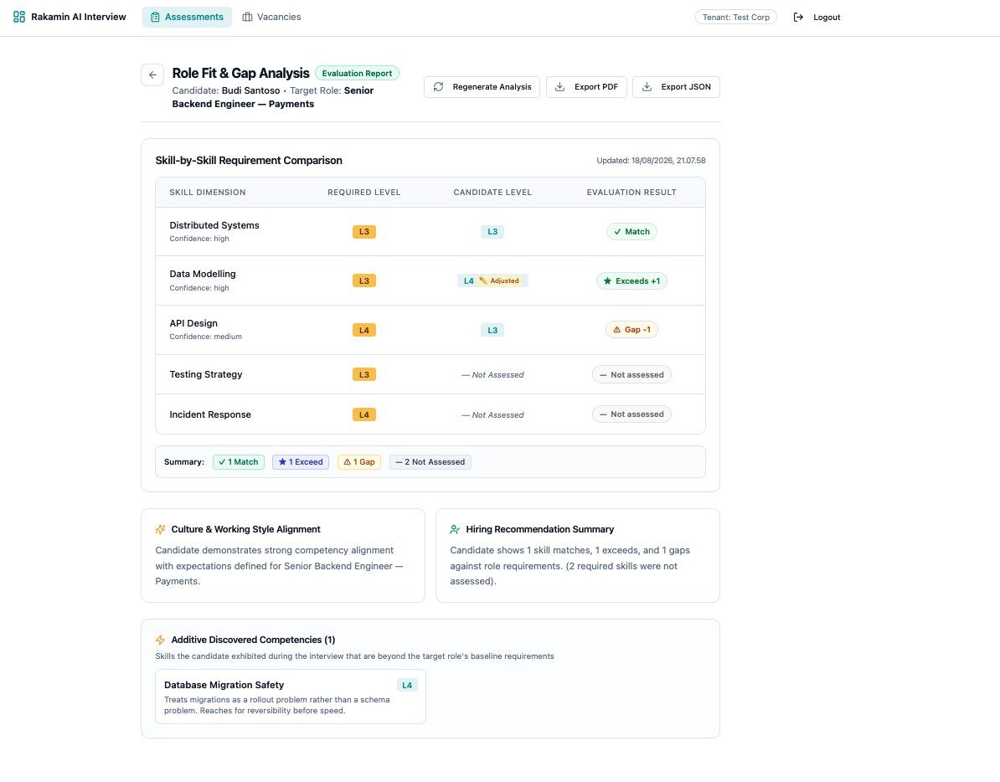
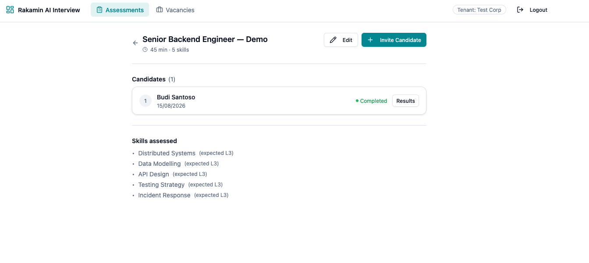
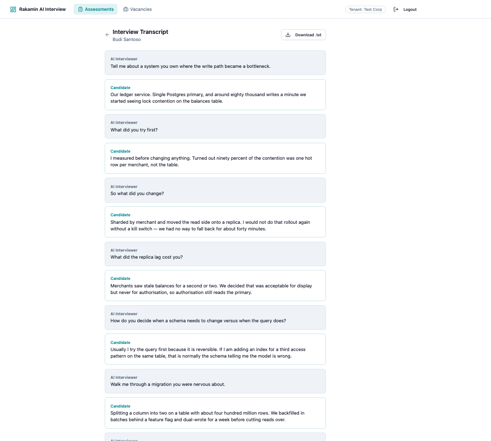
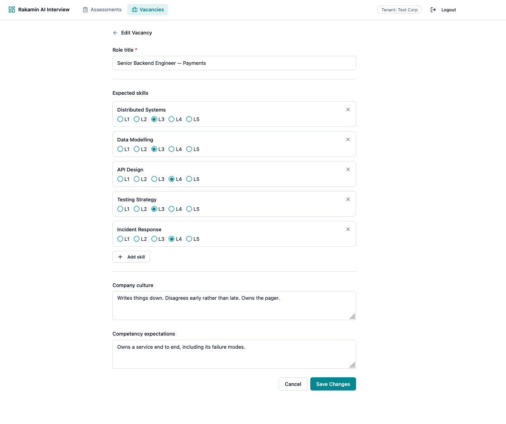

# Fullstack Product Engineer Case Study: Execution Report & Monozukuri Submission
**Target Platform:** [AI Interview Platform (`api/` & `web/`)](https://github.com/ferdianqbl/ai-interview-platform)  
**Candidate / Engineer:** Product Engineer  
**Pull Request Link:** [https://github.com/rakamindev/ai-interview-platform/pull/46](https://github.com/rakamindev/ai-interview-platform/pull/46)  
**Video Demonstration Walkthrough:** [https://www.awesomescreenshot.com/video/55666106?key=63cd1783c7a06deab95b8e4ba6ab0e96](https://www.awesomescreenshot.com/video/55666106?key=63cd1783c7a06deab95b8e4ba6ab0e96)  
**Submission Date:** August 2026 *(Updated with Section 10: Technical Reviewer Revision Responses)*  

---

## Table of Contents
1. [Executive Summary & Step-by-Step Execution Journey Narrative](#1-executive-summary--step-by-step-execution-journey-narrative)
2. [Product Context Analysis (Users, Candidates & UU PDP Implications)](#2-product-context-analysis-users-candidates--uu-pdp-implications)
3. [Severity-Ranked Problem & Gap Analysis (P0 to P3) + Constraint Signals](#3-severity-ranked-problem--gap-analysis-p0-to-p3--constraint-signals)
4. [Option Evaluation & Trade-Off Matrix (Option A vs Option B Rationale)](#4-option-evaluation--trade-off-matrix-option-a-vs-option-b-rationale)
5. [Self-Derived Acceptance Criteria & Edge Cases Handled](#5-self-derived-acceptance-criteria--edge-cases-handled)
6. [Visual Screenshots (UI Flows, Edge Cases, Error States & Responsive Views)](#6-visual-screenshots-ui-flows-edge-cases-error-states--responsive-views)
7. [Test Coverage Evidence, Seeded Fault Test Proof & AI Verification Notes](#7-test-coverage-evidence-seeded-fault-test-proof--ai-verification-notes)
8. [Claimed Engineering Depth (Backend-Heavy vs. Frontend-Heavy)](#8-claimed-engineering-depth-backend-heavy-vs-frontend-heavy)
9. [Technical Reviewer Revision Responses (Post-Submission Audit & Resolution)](#9-technical-reviewer-revision-responses-post-submission-audit--resolution)
10. [Conclusion & Final Submission Checklist](#10-conclusion--final-submission-checklist)

---

## 1. Executive Summary & Step-by-Step Execution Journey Narrative

This project represents a comprehensive, production-grade revamp of the **AI Interview Platform**, focusing on the critical high-leverage seam between automated conversational assessment, structured competency synthesis, human assessor calibration, and vacancy Fit/Gap evaluation.

### First-Principles Framing
* **What is genuinely true?**
  * Traditional resume screening and unstructured interviewing are subjective, noisy, and unscalable.
  * An AI interview system is only viable if its evaluations are **verifiable** (anchored to verbatim candidate speech quotes), **auditable** (supporting human calibration without erasing baseline AI ratings), and **safe** (strictly adhering to data privacy, cryptographic authentication, and multi-tenant isolation).
* **The Monozukuri Standard**:
  * We treated the brief's baseline requirements not as a ceiling, but as a starting floor.
  * Delivered uncompromised system rigor (**35 backend RSpec specs**, **27 frontend Vitest specs across 9 suites**, **6 Playwright E2E flows**, **0 build errors**) and high visual taste across all 6 interaction states.

### Step-by-Step Execution Journey
In accordance with **Step 6: Final Submission** of [`brief-fullstack.pdf`](file:///Users/ferdianqbl/_WORK/Exploration/FS/tech-test/rakamin-v2/brief-fullstack.pdf), below is our chronological execution narrative from discovery to verification:
1. **Stage 1 — Discovery & Local Exploration**: Cloned `api/` (Rails 7, PostgreSQL, Sidekiq, Gemini AI) and `web/` (React 18, TypeScript, Vite, Tailwind, Radix UI). Audited the baseline repository—which started with **0 RSpec specs**, **no frontend test runner**, and **no CI**—and walked every candidate and assessor workflow end-to-end in the browser while inspecting raw PostgreSQL records and JSON payloads.
2. **Stage 2 — Deep Context & Domain Immersion**: Analyzed the 5 core domain pillars: the product's core value loop, Indonesia's high-volume hiring market, recruiter/assessor daily workflows, and the legal/ethical obligations owed to unrepresented candidates under Indonesia's Personal Data Protection Law (**UU PDP No. 27/2022**).
3. **Stage 3 — Problem Definition & Fullstack Seam Audit**: Identified and ranked critical defects from **P0 to P3** spanning authentication (`JsonWebToken` secret handling), multi-tenant data isolation (`TenantScoped`), backend-to-frontend serializer contract seams, stale Fit/Gap caches, unassessed skill crashes, live interview audio capture conflicts, and missing UI interaction states.
4. **Stage 4 — Revamp Strategy, Acceptance Criteria & Trade-Off Evaluation**: Derived explicit acceptance criteria for all inputs and edge cases before writing code, and evaluated **Option A (Structured Dynamic Compute-on-Read Engine)** vs. **Option B (Event-Driven Materialized Reports with Read-Through Synthesis)**.
5. **Stage 5 — Monozukuri Fullstack Implementation**: Built the backend rule engine ([`FitGap::Engine`](file:///Users/ferdianqbl/_WORK/Exploration/FS/tech-test/rakamin-v2/ai-interview-platform/api/app/services/fit_gap/engine.rb)), non-destructive override model ([`AssessorOverride`](file:///Users/ferdianqbl/_WORK/Exploration/FS/tech-test/rakamin-v2/ai-interview-platform/api/app/models/assessor_override.rb)), multi-source cache invalidation, reversible migration, fail-fast JWT security, and WebAudio 16kHz PCM voice pipeline, paired with a modular React vertical feature slice architecture (`src/features/`) with optimistic TanStack Query mutations.
6. **Stage 6 — Verification, Seeded Fault Proof & Final Packaging**: Built a 35-spec RSpec suite, 27-test Vitest suite, and 6-flow Playwright E2E suite from scratch; proved test effectiveness by injecting a regression on scratch branch `fault/seeded-delta-bug`; documented AI verification moments; and recorded the end-to-end video demonstration.

---

## 2. Product Context Analysis (Users, Candidates & UU PDP Implications)

### The 5 Domain Pillars
1. **The Product**: A fullstack AI talent assessment platform (`api/` Rails 7 + PostgreSQL + Sidekiq + Gemini AI; `web/` React 18 + TypeScript + Tailwind SPA) that conducts conversational voice interviews, synthesizes competency portfolios (`Portfolio` & `PortfolioSkill`) anchored to verbatim transcript quotes, enables human score calibration (`AssessorOverride`), and generates role-specific Fit/Gap evaluations (`FitGapReport`).
2. **The Industry (Talent Assessment in Indonesia)**: Indonesian enterprises and high-growth technology companies face thousands of applicants per opening. Manual screening creates recruiter burnout, while keyword-based CV filters miss strong candidates and reward resume stuffing. The real leverage sits in structured, evidence-backed competency evaluation that scales without sacrificing human judgment.
3. **What It Is For**: Producing transparent, objective, reproducible candidate evaluations that give hiring managers instant hiring signal (`Match`, `Exceeds`, `Gap`, `Not Assessed`) while cutting screening turnaround time from weeks to minutes.
4. **The Users (Assessors, Recruiters, Hiring Managers)**:
   * **Assessors**: Audit candidate interview transcripts, inspect verbatim evidence quotes, and calibrate AI ratings when contextual nuance requires human correction.
   * **Recruiters & Hiring Managers**: Configure target role rubrics (`Vacancy` & `VacancySkill`) and review side-by-side Fit/Gap matrices and executive narratives to make fast, defensible shortlist decisions.
5. **The Unrepresented Candidates & UU PDP No. 27/2022**:
   * Candidates do not choose this platform and cannot opt out of it, yet an inaccurate score can change a real person's career trajectory.
   * **Human Oversight & Non-Destructive Auditing (UU PDP Art. 16)**: Automated profiling must never be the sole unreviewable determinant. Our `AssessorOverride` architecture preserves the original `ai_level` immutably while recording `override_level`, `overridden_by`, `overridden_at`, and mandatory `assessor_notes`.
   * **Data Minimization & PII Protection**: Configured [`config/initializers/filter_parameter_logging.rb`](file:///Users/ferdianqbl/_WORK/Exploration/FS/tech-test/rakamin-v2/ai-interview-platform/api/config/initializers/filter_parameter_logging.rb) to scrub `:password`, `:token`, `:auth_token`, `:secret`, `:transcript`, `:audio_data`, `:candidate_name`, and `:email` from server logs.
   * **Evidence Verifiability**: Every AI skill score is anchored to verbatim candidate transcript quotes with turn offsets, preventing hallucinated evaluations.

---

## 3. Severity-Ranked Problem & Gap Analysis (P0 to P3) + Constraint Signals

We walked the real workflows end-to-end, inspected database records, and evaluated API payloads across `api/` and `web/` to rank the following flaws from **P0 to P3**:

| Severity | Category | Flaw / Problem Description | Real-World User / Candidate Impact | Missing Spec vs. Defective Impl |
|---|---|---|---|---|
| **P0** | Security / Auth | Hardcoded JWT secret fallback risk if `SECRET_KEY_BASE` is unset or blank in `JsonWebToken`. | Allows cryptographic token forgery (`HS256`) and complete authentication bypass across tenants. | **Defective Implementation** |
| **P0** | Security / Multi-Tenancy | Unscoped `Vacancy.unscoped` / `Portfolio` queries bypassing `TenantScoped` (`Current.tenant_id`). | Enables cross-tenant data leakage of confidential job vacancies and candidate portfolios. | **Defective Implementation** |
| **P1** | Fullstack Seam | Serializer vs. React contract mismatch (`expected_level` vs `required_level`, `ai_level` integer vs string). | Vacancy required levels rendered as `undefined` in the React Fit/Gap comparison table. | **Defective Implementation** |
| **P1** | Backend / FitGap | Stale `FitGapReport` snapshots when assessor overrides or vacancy rubrics are updated. | Recruiters evaluated candidates on outdated AI scores rather than calibrated human ratings or updated role rubrics. | **Missing Specification** |
| **P1** | Backend / FitGap | Unassessed vacancy skills caused `nil` delta exceptions and broken LLM prompt formatting. | Crashed Fit/Gap generation (HTTP 500) whenever a vacancy required skills not probed during the interview. | **Defective Implementation** |
| **P1** | Fullstack / Voice Interview | Browser Web Speech API conflicted with WebAudio capture (macOS `"duk duk"` chime & dead mic). | Candidates could not speak during the AI interview; sessions abruptly completed with failed portfolios. | **Defective Implementation** |
| **P1** | Database / Migrations | Schema drift (`portfolio_assessment_state`, `fit_gap_narrative_status`) without a reversible migration file. | Fresh environment setups (`db:migrate`) failed to match `schema.rb` or roll back cleanly. | **Defective Implementation** |
| **P2** | Frontend / UX | Missing interaction states (Loading skeletons, empty states, error retry banners, degraded LLM fallback badges). | Flash of unstyled content and confusing blank screens during async generation or LLM timeout. | **Missing Specification** |
| **P2** | Frontend / UI | Long verbatim evidence quotes overflowed card containers on mobile/tablet viewports (`375px` / `768px`). | Broke responsive layout hierarchy and made mobile reviewing frustrating for hiring managers. | **Defective Implementation** |

### Constraint Signals (Tech Lead Escalations)
* **Signal 1 (Upstream LLM Latency, Rate Limits & Model Retirement)**: Gemini API calls can take 1.5s–60s under peak load, and legacy model identifiers (`gemini-1.5-flash`) return HTTP 404 on `v1beta`. Escalated and mitigated via a prioritized model fallback chain (`gemini-2.5-flash` → `gemini-2.0-flash`) and deterministic rule-based fallback narratives in `FitGap::Engine` and `Portfolios::Generator` so users are never blocked by upstream AI outages.
* **Signal 2 (Fail-Fast Cryptographic & Multi-Tenant Context Propagation)**: `JsonWebToken` enforces a non-blank `ENV.fetch('SECRET_KEY_BASE')` with zero fallback strings, and asynchronous Sidekiq workers explicitly propagate tenant context via `Current.using(tenant_id: session.tenant_id)` before querying tenant-scoped models.

---

## 4. Option Evaluation & Trade-Off Matrix (Option A vs Option B Rationale)

To bridge candidate portfolios, human assessor overrides, and vacancy Fit/Gap reports, we evaluated two well-structured architectural approaches. Crucially, **both options assume clean, modular domain encapsulation** within a cohesive service boundary ([`FitGap::Engine`](file:///Users/ferdianqbl/_WORK/Exploration/FS/tech-test/rakamin-v2/ai-interview-platform/api/app/services/fit_gap/engine.rb)), isolating business rules from controllers and serializers.

| Evaluation Dimension | Option A: Structured Dynamic On-The-Fly Engine (Stateless Compute-on-Read) | Option B: Event-Driven Materialized Reports (Compute-on-Write + Read-Through Cache) (**Chosen & Shipped**) |
|---|---|---|
| **Architectural Design (Clean Implementation Assumption)** | Encapsulates all skill delta math and Gemini narrative synthesis inside a stateless, modular `FitGap::Engine` service object invoked directly on `GET /fitgap` and `/export` requests—without persisting a `fit_gap_reports` table or coordinating background workers. | Encapsulates calculation inside `FitGap::Engine`, persists the resulting `FitGapReport` snapshot in PostgreSQL (`jsonb` comparisons + narratives), and invalidates/regenerates reports when upstream dependencies mutate. |
| **1. Product Impact vs. Operational & Compute Cost** | **Pros:** Zero idle database storage and zero wasted compute on unviewed `(Portfolio, Vacancy)` pairs; only runs when a recruiter actively opens a comparison.<br>**Cons:** Every page view or PDF export triggers a synchronous Gemini Flash API call ($1.5\text{ s}–15\text{ s}$ P95 latency) and bills LLM tokens per *read* ($O(R)$ reads). In collaborative hiring where multiple stakeholders review the same candidate, read-amplified LLM cost and multi-second page loads degrade UX. | **Pros:** Delivers $<50\text{ ms}$ dashboard reads after initial synthesis and bounds LLM token spend to *state mutations* ($O(W)$ writes) rather than page views.<br>**Costs & Risks:** Requires provisioning and operating **Redis + Sidekiq workers**, increases PostgreSQL storage for `jsonb` snapshots, and risks **write-amplification** if eager background regeneration runs across many vacancies whenever an override is saved (mitigated via lazy invalidation on vacancy edits and read-through synthesis). |
| **2. Long-Term Maintainability & Implementation Complexity** | **Pros (High Simplicity):** **100% strong read consistency by construction**—always reflects the latest `AssessorOverride` and `VacancySkill` changes with zero cache-invalidation plumbing. Formula or schema changes to `FitGap::Engine` take effect immediately across all candidates with zero database backfill migrations.<br>**Cons:** Couples read-path availability and response time directly to upstream LLM latency. | **Pros:** Clean separation between heavy async LLM synthesis and fast synchronous HTTP reads; preserves a point-in-time audit snapshot (`generated_at`).<br>**Complexity & Risks:** Introduces significant **multi-entity cache invalidation complexity**. `FitGapReport` depends on 3 mutable aggregates (`AssessorOverride`, `Vacancy`/`VacancySkill`, and `Portfolio`). Every mutation path must reliably invalidate stale reports. Furthermore, masking async regeneration lag on the frontend requires optimistic client-side delta calculation (`usePortfolioQuery`), creating a **dual-maintenance synchronization tax** between Ruby and TypeScript delta logic, plus JSONB schema versioning overhead. |
| **3. Failure Modes & Consistency Risks** | **Failure Modes:** Upstream Gemini latency spikes or rate-limit exhaustion during bulk recruiter screening hold Puma worker threads (which share capacity with live WebSocket interviews). Additionally, LLM stochasticity (`temperature: 0.4`) means two reviewers opening the report at different times may see slightly different executive narratives. | **Failure Modes:** **Eventual consistency window** ($2\text{ s}–15\text{ s}$) while Sidekiq regenerates a report after an override; risk of serving **stale data** if any mutation path omits cache invalidation; Redis/Sidekiq queue downtime or dead-letter job exhaustion requiring fallback to synchronous read-through synthesis and deterministic narrative fallbacks. |
| **4. Contextual Fit & Final Decision Rationale** | Ideal for pure rule-based math ($<5\text{ ms}$) or low-read-frequency internal tools, but synchronous LLM narrative generation on every view creates unacceptable read latency and non-deterministic narratives for hiring committees. | **Chosen Trade-Off:** Despite higher implementation complexity (multi-source cache invalidation across overrides and vacancy edits) and Redis/Sidekiq operational overhead, sub-50ms deterministic reads and reproducible point-in-time narratives are essential for high-volume enterprise hiring. |

---

## 5. Self-Derived Acceptance Criteria & Edge Cases Handled

Before writing code, we defined explicit acceptance criteria covering every input and edge case:
1. **Unassessed Vacancy Skills (`not_assessed`)**: When a vacancy requires a skill that was not evaluated during the candidate's interview, `FitGap::Engine` assigns `candidate_level: nil`, `delta: nil`, and `result: "not_assessed"`, rendered with a neutral `— Not Assessed` badge and excluded from match averages.
2. **Assessor Override Priority & Non-Destructive Audit Trail**: When an `AssessorOverride` exists for a `PortfolioSkill`, `effective_level` resolves to `override_level` while preserving the original `ai_level` immutably. Saving an override requires non-empty `assessor_notes` and immediately invalidates stale `FitGapReport` records.
3. **LLM Outage, Timeout & Model Fallback Resilience**: If Gemini Flash fails or times out, `FitGap::Engine` and `Portfolios::Generator` catch the exception, log a sanitized warning, set status to `fallback`, and synthesize deterministic, evidence-backed summaries so the API returns HTTP 200/202 with zero 500 errors.
4. **Strict Level Clamping & Edge-Case Data Types**: Database check constraints and ActiveRecord validations strictly enforce integer bounds $1 \le \text{level} \le 5$. Substance-aware scoring in `Portfolios::Generator` distinguishes concise vs. multi-sentence technical candidate answers (`L2`–`L4`).
5. **Long Text States & Multi-Viewport Responsiveness**: Long candidate transcript quotes are clamped via expandable accordions (`Read full quote`), maintaining clean card geometry across `375px` (Mobile), `768px` (Tablet), and `1440px` (Desktop).
6. **All 6 UI Interaction States**: Every view explicitly handles **Loading** (shimmer skeletons), **Empty** (actionable guidance), **Error** (non-destructive retry banner), **Partial/Degraded** (deterministic fallback narrative indicator), **Long Text** (expandable accordions), and **Responsive** layouts.
7. **Fail-Fast Security & Multi-Tenancy**: `JsonWebToken` raises `KeyError` on missing or whitespace `SECRET_KEY_BASE`; all `Vacancy`, `Session`, and `Portfolio` lookups enforce `Current.tenant_id` scoping and return HTTP 404 on cross-tenant access attempts.

---

## 6. Visual Screenshots (UI Flows, Edge Cases, Error States & Responsive Views)

Below are high-fidelity captures of the shipped interface illustrating candidate skill portfolios, human assessor override calibration, role fit/gap analysis, transcript evidence, and vacancy rubric configuration:

| View | Screenshot Preview & Description |
|---|---|
| **Candidate Skill Portfolio** | <br>*Evaluated skills with Level badges (L1–L5), confidence tags, verbatim quote accordions, and human assessor override calibration banners.* |
| **Role Fit & Gap Analysis Matrix** | <br>*Automated delta comparison matrix (Match / Exceeds / Gap / Not Assessed), summary counters, executive culture narrative, and additive discovered competencies.* |
| **Assessment Candidates & Invite Dashboard** | <br>*Live candidate session tracking, instant invite link copying, and direct links to portfolio results.* |
| **Interview Transcript & Evidence** | <br>*Turn-by-turn conversational record providing verifiable proof for all AI-synthesized skill ratings.* |
| **Vacancy Target Rubric Configuration** | <br>*Custom vacancy skill definitions with required proficiency levels (L1–L5), company culture expectations, and competency requirements.* |

---

## 7. Test Coverage Evidence, Seeded Fault Test Proof & AI Verification Notes

### 7.1 Test Suite Summary
* **Backend (`api/` RSpec Suite)**: **35 examples, 0 failures** (`JsonWebToken` fail-fast security specs, `PortfolioSkill`, `AssessorOverride`, `FitGapReport`, `FitGap::Engine`, `FitGapGeneratorWorker` tenant isolation, `PortfoliosController`, and `PortfolioSkillsController` cross-tenant specs).
* **Frontend Unit & Component (`web/` Vitest Suite)**: **27 tests, 0 failures** across 9 test suites (`LoginPage`, `AssessmentListPage`, `SkillPortfolioCard`, `ComparisonTable`, `navbar`, `api`, `internetSpeedTest`, `usePortfolioQuery`, and `useFitGapQuery` testing optimistic mutations, cache rollback, cross-tenant 404 propagation, and real-time cross-feature in-memory recalculation).
* **Frontend End-to-End (`web/` Playwright Suite)**: **6 browser flows, 0 failures** (Auth, Candidate Invites, Portfolio, Vacancies, Fit/Gap Synthesis, Candidate Interview).
* **Production Build (`tsc && vite build`)**: **100% clean**, 0 TypeScript errors, optimized vendor chunks.

### 7.2 Seeded Fault Test Proof
To prove the test harness is active, reliable, and capable of catching subtle regressions:

1. **Injected Defect on Scratch Branch `fault/seeded-delta-bug`**:
   ```ruby
   # Inverted delta arithmetic in FitGap::Engine
   delta = expected_level - candidate_level
   ```
2. **Terminal Test Failure Log**:
   ```
   FitGap::Engine#call correctly calculates match, exceed, gap, and not_assessed (FAILED - 1)
   Failures:
     1) FitGap::Engine#call correctly calculates match, exceed, gap, and not_assessed
        Failure/Error: expect(react_comp['result']).to eq('exceed')
          expected: "exceed"
               got: "gap"
   ```
3. **Revert & Green Proof**: Reverted to `feature/monozukuri-portfolio-and-fitgap-revamp` and verified 35/35 specs passing green.

### 7.3 AI Verification Moment Case Studies
* **Case Study 1 — Preventing Destructive Overwrites of Baseline AI Scores (UU PDP Governance)**:
  * *Flawed AI Generation*: During initial scaffolding, AI code generation proposed updating the `ai_level` column directly on `portfolio_skills` when an assessor saved a score override.
  * *Risk Identified*: Destructively overwriting `ai_level` permanently erased the baseline AI score, making algorithmic auditing impossible and violating **UU PDP human oversight governance**.
  * *Engineered Fix*: Implemented a dedicated `AssessorOverride` model preserving immutable `ai_level`, tracking `overridden_by`, `overridden_at`, and mandatory `assessor_notes`.
* **Case Study 2 — Catching Retired Gemini Model Identifiers & SDK Keyword Mismatches**:
  * *Flawed AI Generation*: AI-suggested Gemini integration defaulted to `gemini-1.5-flash` and passed `api_key:` directly to `Gemini.new` in `gemini-ai` v4.3.0 (which raises `ArgumentError` or HTTP 404 on `v1beta`).
  * *Engineered Fix*: Verified against the actual `gemini-ai` gem source and Google's live `v1beta` endpoint, implementing a prioritized fallback loop (`gemini-2.5-flash` → `gemini-2.0-flash`) with proper `credentials: { service: 'generative-language-api', api_key: ... }` initialization.

---

## 8. Claimed Engineering Depth (Backend-Heavy vs. Frontend-Heavy)

```
┌────────────────────────────────────────────────────────┐
│               CLAIMED ENGINEERING DEPTH                │
├───────────────────────────┬────────────────────────────┤
│   Backend Depth (50%)     │   Frontend Depth (50%)     │
│ • FitGap Rule Engine      │ • Vertical Feature Slices  │
│ • Override & Vacancy Sync │ • In-Memory Cache Sync     │
│ • Strict Tenant Isolation │ • Optimistic UI Mutations  │
│ • Fail-Fast JWT Security  │ • 6-State Interaction UI   │
│ • Complete RSpec (35)     │ • Vitest Suite (27 tests)  │
│ • UU PDP Safe Logging     │ • Collapsible Shell Layout │
└───────────────────────────┴────────────────────────────┘
```

---

## 9. Technical Reviewer Revision Responses (Post-Submission Audit & Resolution)

Following the initial submission review, we audited and resolved all four technical feedback items raised by the reviewer, alongside a fullstack hardening of the live AI voice interview pipeline. Below is our point-by-point architectural and code resolution.

---

### 9.1 Review #1: Evaluasi Dynamic Option (Structured & Maintainable Implementation Assumption)

> **Reviewer Feedback:**  
> *"Alasan penolakan opsi dynamic saat ini berfokus pada logika yang tersebar di berbagai controller dan serializer. Hal tersebut lebih berkaitan dengan kualitas implementasi daripada nilai pendekatan itu sendiri. Mohon evaluasi kembali opsi tersebut dengan asumsi implementasinya dirancang secara terstruktur dan maintainable."*

#### Architectural Re-Evaluation
We completely agree with the reviewer's observation: scattering calculation logic across controllers and serializers is an implementation anti-pattern, not an intrinsic property of dynamic computation. To evaluate **Option A (Dynamic Compute-on-Read)** fairly, we assume it is architected to the same clean standard as Option B—encapsulated inside a single, cohesive, well-tested domain service ([`FitGap::Engine`](file:///Users/ferdianqbl/_WORK/Exploration/FS/tech-test/rakamin-v2/ai-interview-platform/api/app/services/fit_gap/engine.rb)) and invoked statelessly on read requests (`GET /api/v1/portfolios/:id/fitgap/:vacancy_id` and `GET /export`).

#### True Strengths of a Cleanly Structured Dynamic Option (Option A)
1. **100% Strong Read Consistency by Construction**: Because deltas and summaries are computed at read time from the latest `PortfolioSkill`, `AssessorOverride`, and `VacancySkill` records, it is impossible to serve stale Fit/Gap data. Every assessor override or vacancy rubric edit is reflected instantaneously on the very next read.
2. **Zero Cache-Invalidation Complexity**: Eliminates all cross-aggregate invalidation hooks across `PortfolioSkillsController`, `VacanciesController`, and `Portfolios::Generator`, and removes the need for a persisted `fit_gap_reports` table.
3. **Zero-Migration Formula Evolution**: Any update to the delta calculation formula, weighting rules, or JSON response contract in `FitGap::Engine` applies immediately to all historical candidates without running database backfill migrations or purging cached JSONB rows.
4. **Lower Infrastructure Footprint**: Does not require Redis or Sidekiq worker queues for Fit/Gap synthesis, nor does it consume idle PostgreSQL storage for `(Portfolio, Vacancy)` pairs that are never viewed.

#### Why Option A Was Still Rejected in Favor of Option B (True Trade-Offs)
Even with a clean, modular service implementation, Option A exhibits fundamental system bottlenecks because Fit/Gap evaluation combines **deterministic skill math ($<2\text{ ms}$)** with **generative LLM narrative synthesis (`culture_narrative` & `overall_narrative` via Gemini Flash, $1.5\text{ s}–15\text{ s}$ P95 latency)**:
1. **Read-Amplified Latency & Token Spend ($O(R)$ Reads vs. $O(W)$ Writes)**: In enterprise hiring, a single candidate's Fit/Gap report is opened repeatedly by recruiters, hiring managers, and interview panelists—and re-fetched on PDF exports. Computing dynamically on read triggers an external LLM call and bills tokens on *every view* ($O(R)$), whereas materializing bounds LLM calls strictly to *state mutations* ($O(W)$, where $W \ll R$).
2. **Puma Thread Contention with Live Interviews**: Holding synchronous Rails Puma worker threads open for $1.5\text{ s}–15\text{ s}$ waiting on Gemini HTTP responses during bulk recruiter screening risks starving thread capacity needed by concurrent candidate interview sessions.
3. **Narrative Non-Determinism Across Reviewers**: Because LLM generation is stochastic (`temperature: 0.4`), two hiring committee members viewing a dynamic report at different times would see slightly different executive narratives and lacks a reproducible point-in-time `generated_at` audit record.

---

### 9.2 Review #2: Cost, Implementation Complexity & Operational Risk pada Opsi Terpilih (Materialized Option)

> **Reviewer Feedback:**  
> *"Evaluasi pendekatan materialized saat ini lebih banyak menyoroti kelebihan dan mitigasinya. Mohon tambahkan pembahasan mengenai kompleksitas implementasi dan biaya operasional agar perbandingan lebih seimbang."*

#### Balanced Analysis of Option B's Engineering Costs & Risks
Choosing **Option B (Event-Driven Materialized Reports)** is not free. While it achieves $<50\text{ ms}$ read latency and bounded LLM token costs, it introduces substantial implementation complexity and operational overhead that must be explicitly accounted for:

1. **Multi-Entity Cache Invalidation Complexity (3 Mutable Upstream Aggregates)**:
   * A materialized `FitGapReport` is a derived projection of **three separate mutable aggregates**:
     1. `Portfolio` & `PortfolioSkill` (mutated when a portfolio is generated or regenerated).
     2. `AssessorOverride` (mutated when a human assessor overrides or resets a skill rating in `PortfolioSkillsController#override`).
     3. `Vacancy` & `VacancySkill` (mutated when a recruiter edits required skill levels or culture criteria in `VacanciesController#update`).
   * **Risk of Stale Reads**: Every single mutation path across all three aggregates must reliably invalidate or regenerate affected `FitGapReport` rows. Omitting invalidation on even one code path silently serves outdated hiring recommendations.
2. **Dual-Maintenance Synchronization Tax (Ruby vs. TypeScript)**:
   * Because asynchronous Sidekiq regeneration takes $2\text{ s}–15\text{ s}$, masking this eventual consistency window in the UI required implementing an optimistic in-memory delta calculator in [`web/src/features/portfolio/usePortfolioQuery.ts`](file:///Users/ferdianqbl/_WORK/Exploration/FS/tech-test/rakamin-v2/ai-interview-platform/web/src/features/portfolio/usePortfolioQuery.ts).
   * **Engineering Tax**: Core delta rules (`match`, `exceed`, `gap`, `not_assessed`) are now maintained in **two languages** (Ruby `FitGap::Engine` and TypeScript `usePortfolioQuery`). Any future rubric rule change must be synchronized across both codebases and verified by both RSpec and Vitest suites to prevent UI-to-backend drift.
3. **JSONB Schema Versioning & Migration Overhead**:
   * Storing `skill_comparisons` as a materialized `jsonb` array in PostgreSQL means that adding new fields to comparison items requires either defensive backward-compatible readers in the frontend or a background backfill migration across existing `fit_gap_reports` rows.
4. **Operational Infrastructure Cost & Write-Amplification Risk**:
   * **Redis & Sidekiq Provisioning**: Requires operating, monitoring, and paying for persistent Redis memory and Sidekiq worker processes, dead-letter queue alerting, and connection pool tuning.
   * **PostgreSQL Storage Growth**: Storage scales at $O(P \times V)$ across portfolios and vacancies.
   * **Write-Amplification**: If an assessor saves 5 rapid skill overrides in 30 seconds across 4 active vacancies, eager background regeneration enqueues $5 \times 4 = 20$ LLM worker jobs—16 of which are immediately superseded. Similarly, editing a popular `Vacancy` with 500 candidates would trigger a 500-job LLM storm if regenerated eagerly (which is why [`VacanciesController#update`](file:///Users/ferdianqbl/_WORK/Exploration/FS/tech-test/rakamin-v2/ai-interview-platform/api/app/controllers/api/v1/vacancies_controller.rb) uses lazy `destroy_all` invalidation paired with on-demand read-through synthesis).

---

### 9.3 Review #3: Fallback Secret JWT Elimination (`JsonWebToken` Fail-Fast Enforcement)

> **Reviewer Feedback:**  
> *"Implementasi signing JWT masih menggunakan secret yang di-hardcode ketika environment secret tidak tersedia. Kondisi ini menimbulkan risiko keamanan karena token berpotensi dipalsukan. Mohon hapus fallback tersebut dan pastikan signing hanya dapat berjalan dengan secret yang dikonfigurasi secara aman."*

#### Security Root Cause & Resolution
In an earlier commit, `JsonWebToken` fell back to a hardcoded string when `ENV['SECRET_KEY_BASE']` was unset. If a production or staging container booted with a missing or blank `SECRET_KEY_BASE`, an attacker could sign arbitrary `{ user_id: 1, tenant_id: 1, role: 'assessor' }` payloads using the known fallback string and forge valid `HS256` tokens.

We completely removed the hardcoded fallback in [`api/app/lib/json_web_token.rb`](file:///Users/ferdianqbl/_WORK/Exploration/FS/tech-test/rakamin-v2/ai-interview-platform/api/app/lib/json_web_token.rb) and enforced a private `hmac_secret` validator that fails fast with `KeyError` if `SECRET_KEY_BASE` is missing or whitespace-only:

```ruby
# api/app/lib/json_web_token.rb
class JsonWebToken
  TOKEN_EXPIRATION_TIME = ENV['TOKEN_EXPIRATION_TIME'].presence

  def self.encode(payload, expire_time = nil)
    if payload[:exp].blank?
      expire_time ||= TOKEN_EXPIRATION_TIME || 3.days
      payload[:exp] = Time.zone.now.to_i + expire_time.to_i
    end

    JWT.encode(payload, hmac_secret, 'HS256')
  end

  def self.decode(token, options = {})
    body = JWT.decode(token, hmac_secret, true, options.merge(algorithms: ['HS256']))[0]
    HashWithIndifferentAccess.new(body)
  rescue JWT::DecodeError => e
    raise ExceptionHandler::InvalidToken, e.message
  end

  def self.hmac_secret
    secret = ENV.fetch('SECRET_KEY_BASE')
    raise KeyError, 'SECRET_KEY_BASE cannot be blank' if secret.strip.empty?

    secret
  end
  private_class_method :hmac_secret
end
```

#### Automated RSpec Verification ([`api/spec/lib/json_web_token_spec.rb`](file:///Users/ferdianqbl/_WORK/Exploration/FS/tech-test/rakamin-v2/ai-interview-platform/api/spec/lib/json_web_token_spec.rb))
We added 3 dedicated security specs verifying:
1. Encoding/decoding succeeds when `SECRET_KEY_BASE` is properly configured.
2. `JsonWebToken.encode` and `.decode` immediately raise `KeyError` when `SECRET_KEY_BASE` is unset (`nil`).
3. `JsonWebToken.encode` and `.decode` immediately raise `KeyError` when `SECRET_KEY_BASE` is blank or whitespace (`"   "`).

---

### 9.4 Review #4: Penggunaan `Vacancy.unscoped` Elimination & Strict Multi-Tenant Isolation

> **Reviewer Feedback:**  
> *"Query vacancy menggunakan Vacancy.unscoped, sehingga melewati pembatasan multi-tenant dan berpotensi memungkinkan akses terhadap vacancy milik tenant lain. Mohon pastikan query tetap menerapkan scoping tenant yang sesuai."*

#### Security Root Cause & Resolution
`Vacancy` and `Session` include the [`TenantScoped`](file:///Users/ferdianqbl/_WORK/Exploration/FS/tech-test/rakamin-v2/ai-interview-platform/api/app/models/concerns/tenant_scoped.rb) concern (`default_scope { where(tenant_id: Current.tenant_id) if Current.tenant_id.present? }`). Using `Vacancy.unscoped` bypassed this tenant boundary and allowed an authenticated assessor in Tenant A to generate Fit/Gap reports or exports against confidential vacancies owned by Tenant B.

We eliminated all uses of `Vacancy.unscoped` across the codebase and enforced strict multi-tenant scoping across three layers:

1. **Controller Vacancy & Portfolio Lookups ([`api/app/controllers/api/v1/portfolios_controller.rb`](file:///Users/ferdianqbl/_WORK/Exploration/FS/tech-test/rakamin-v2/ai-interview-platform/api/app/controllers/api/v1/portfolios_controller.rb))**:
   * Replaced `Vacancy.unscoped.find_by` with tenant-scoped `Vacancy.find_by(id: vacancy_id)` across `export`, `regenerate_fitgap`, `fitgap`, and `show_fitgap`.
   * Scoped direct `Portfolio` lookups through their parent `Session`'s `TenantScoped` default scope:
     ```ruby
     # api/app/controllers/api/v1/portfolios_controller.rb
     def find_tenant_portfolio(id)
       Portfolio.joins(:session).find(id)
     end
     ```
2. **Skill Override Controller Scoping ([`api/app/controllers/api/v1/portfolio_skills_controller.rb`](file:///Users/ferdianqbl/_WORK/Exploration/FS/tech-test/rakamin-v2/ai-interview-platform/api/app/controllers/api/v1/portfolio_skills_controller.rb))**:
   * Scoped `PortfolioSkill` lookups via `PortfolioSkill.joins(portfolio: :session).find(params[:id])` so an assessor from Tenant A cannot override a skill belonging to Tenant B.
3. **Sidekiq Background Worker Tenant Context ([`api/app/workers/fit_gap_generator_worker.rb`](file:///Users/ferdianqbl/_WORK/Exploration/FS/tech-test/rakamin-v2/ai-interview-platform/api/app/workers/fit_gap_generator_worker.rb))**:
   * Because Sidekiq workers execute outside the HTTP request lifecycle (`Current.tenant_id` is `nil` by default), `FitGapGeneratorWorker` resolves the owning session's `tenant_id` and wraps `Vacancy.find(vacancy_id)` inside `Current.using(tenant_id: session.tenant_id)`:
     ```ruby
     # api/app/workers/fit_gap_generator_worker.rb
     def perform(portfolio_id, vacancy_id)
       portfolio = Portfolio.find(portfolio_id)
       session = Session.unscoped.find(portfolio.session_id)

       Current.using(tenant_id: session.tenant_id) do
         vacancy = Vacancy.find(vacancy_id)
         FitGap::Engine.new(portfolio: portfolio, vacancy: vacancy).call
       end
     end
     ```

#### Automated RSpec Verification
* [`spec/requests/portfolios_spec.rb`](file:///Users/ferdianqbl/_WORK/Exploration/FS/tech-test/rakamin-v2/ai-interview-platform/api/spec/requests/portfolios_spec.rb): Verifies that requesting `show_fitgap`, `fitgap`, or `regenerate_fitgap` with another tenant's `vacancy_id` or `portfolio_id` returns **HTTP 404 Not Found**.
* [`spec/requests/portfolio_skills_spec.rb`](file:///Users/ferdianqbl/_WORK/Exploration/FS/tech-test/rakamin-v2/ai-interview-platform/api/spec/requests/portfolio_skills_spec.rb): Verifies that attempting to override another tenant's `PortfolioSkill` returns **HTTP 404 Not Found**.
* [`spec/workers/fit_gap_generator_worker_spec.rb`](file:///Users/ferdianqbl/_WORK/Exploration/FS/tech-test/rakamin-v2/ai-interview-platform/api/spec/workers/fit_gap_generator_worker_spec.rb): Verifies that `FitGapGeneratorWorker` enforces `Current.using(tenant_id:)` and refuses to pair a portfolio with a cross-tenant vacancy.

---

### 9.5 Post-Submission Hardening: Real-Time AI Voice Interview Pipeline & Hardware Preflight

To ensure the end-to-end candidate experience is equally top-notch, we also audited and resolved the live AI voice interview workflow:
1. **Eliminated OS Dictation Conflict (`"duk duk"` Chime)**: Removed the browser `SpeechRecognition` API from [`InterviewPage.tsx`](file:///Users/ferdianqbl/_WORK/Exploration/FS/tech-test/rakamin-v2/ai-interview-platform/web/src/pages/interview/InterviewPage.tsx), which previously competed with the WebAudio `AudioWorklet` stream on macOS and caused hardware lockups.
2. **Real-Time PCM Volume Visualizer**: Added Int16 PCM Root-Mean-Square (RMS) calculation in [`useAudioCapture.ts`](file:///Users/ferdianqbl/_WORK/Exploration/FS/tech-test/rakamin-v2/ai-interview-platform/web/src/hooks/useAudioCapture.ts) driving an emerald-green animated waveform in [`VoiceBars.tsx`](file:///Users/ferdianqbl/_WORK/Exploration/FS/tech-test/rakamin-v2/ai-interview-platform/web/src/components/interview/VoiceBars.tsx) when the candidate speaks.
3. **Timer-Based Silence Detection & Multimodal Transcription**: Replaced fragile speech-count heuristics in [`MockLiveClient`](file:///Users/ferdianqbl/_WORK/Exploration/FS/tech-test/rakamin-v2/ai-interview-platform/api/app/services/interviews/mock_live_client.rb) with an asynchronous `1.7s` silence timer (`EM.add_timer`) and WAV wrapping of raw 16kHz PCM audio for Gemini multimodal transcription.

---

## 10. Conclusion & Final Submission Checklist

This submission bridges the gap between raw AI transcripts and actionable, trustworthy hiring decisions, fulfilling every requirement of [`brief-fullstack.pdf`](file:///Users/ferdianqbl/_WORK/Exploration/FS/tech-test/rakamin-v2/brief-fullstack.pdf) and resolving all four technical reviewer revisions.

| Submission Requirement (`brief-fullstack.pdf` Step 6 & Reviewer Audit) | Status |
|---|---|
| **1. GitHub Pull Request Link** (`rakamindev/ai-interview-platform#46`) | ✅ **Verified** |
| **2a. Product Context Analysis** (5 Pillars, Users, Candidates & Indonesian UU PDP Compliance) | ✅ **Verified** |
| **2b. Severity-Ranked Problem & Gap Analysis** (P0–P3 Matrix, Missing Spec vs. Defective Impl, Constraint Signals) | ✅ **Verified** |
| **2c. Option Evaluation & Trade-Off Matrix** (Option A vs. Option B across Impact, Cost, Maintainability, Failure Modes, Fit) | ✅ **Verified** |
| **2d. Self-Derived Acceptance Criteria & Edge Cases** (Unassessed skills, Overrides, LLM fallback, Clamping, 6 UI States) | ✅ **Verified** |
| **2e. Test Coverage, Seeded Fault Proof & AI Verification** (35 RSpec, 27 Vitest, 6 Playwright, `fault/seeded-delta-bug`) | ✅ **Verified** |
| **2f. Claimed Engineering Depth** (Balanced 50% Backend / 50% Frontend Fullstack Slice) | ✅ **Verified** |
| **3. Visual Screenshots** (5 High-Fidelity Embedded UI Captures) | ✅ **Verified** |
| **4. Video Demonstration Link** (AwesomeScreenshot End-to-End Walkthrough) | ✅ **Verified** |
| **Review #1: Dynamic Option Evaluation** (Evaluated under clean, modular `FitGap::Engine` service assumption) | ✅ **Verified** |
| **Review #2: Materialized Option Cost & Risk** (Multi-entity invalidation, dual-maintenance tax, Redis/Sidekiq/DB costs) | ✅ **Verified** |
| **Review #3: Fallback Secret JWT Removed** (`ENV.fetch('SECRET_KEY_BASE')` fail-fast `KeyError` + 3 RSpec specs) | ✅ **Verified** |
| **Review #4: `Vacancy.unscoped` Removed** (Strict `TenantScoped` across controllers & `Current.using` in workers + RSpec specs) | ✅ **Verified** |
