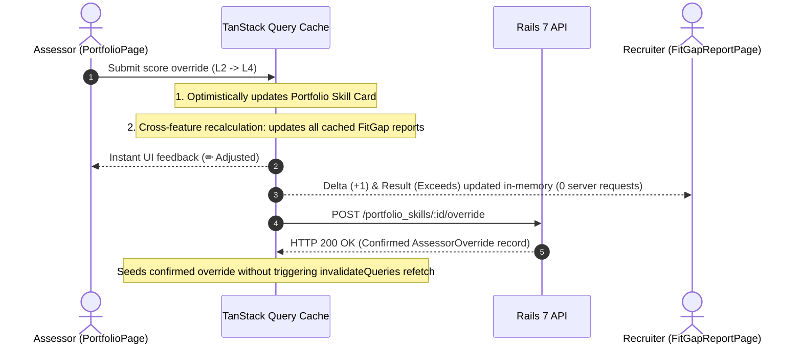
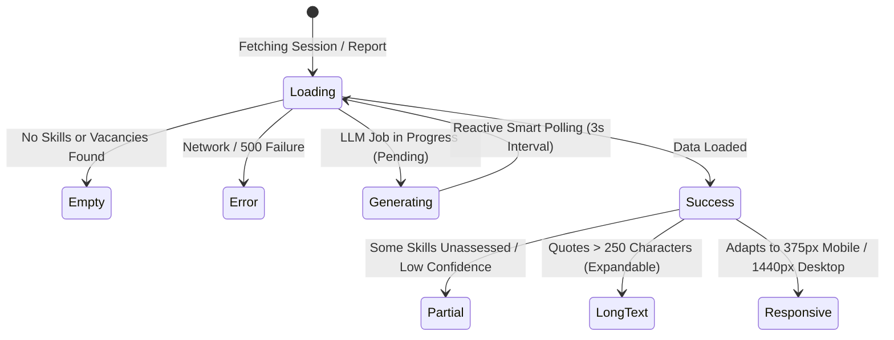

# Frontend Architecture & Component Design Document
## AI Interview Platform Web (React 18 + TypeScript + Vite 5 + Tailwind CSS + Radix UI + TanStack Query)

---

## 1. High-Level Architecture & Page Flow

The frontend is a modern, responsive Single Page Application (SPA) built with **React 18**, **TypeScript**, and **Vite 5**, adopting an enterprise **Vertical Feature Slices** architecture, **TanStack Query v5** for reactive in-memory caching and optimistic mutations, and **Radix UI** primitives for accessible, high-taste craftsmanship (*Monozukuri*).

```mermaid
graph TD
    subgraph ProvidersLayer [Root Providers & Layout Shell]
        AppRoot[App Root]
        QueryProvider[TanStack QueryClientProvider]
        ThemeProvider[Theme Provider - Dark/Light]
        PrivateShell[Collapsible Private Layout Shell]
        PublicLayout[Candidate Public Layout]
    end

    subgraph RoutingLayer [Centralized Router - React Router DOM v7]
        LazyRouter[Centralized Router with React.lazy Code Splitting]
        AuthRoutes[/login]
        AssessmentsRoutes[/assessments, /new, /edit, /invite]
        VacanciesRoutes[/vacancies, /new, /edit]
        EvaluationRoutes[/portfolio, /fitgap, /live, /transcript]
        InterviewRoutes[/interview/:token]
    end

    subgraph FeatureSlices [Vertical Feature Slices - src/features/]
        AuthFeature[features/auth]
        AssessmentsFeature[features/assessments]
        VacanciesFeature[features/vacancies]
        EvaluationFeature[features/evaluation]
        InterviewFeature[features/interview]
    end

    subgraph CacheLayer [TanStack Query Real-Time Cache Layer]
        QueryCache[(In-Memory QueryCache)]
        OptimisticMutations[Optimistic Mutations with Auto-Rollback]
        CrossFeatureSync[Cross-Feature In-Memory Cache Sync]
    end

    AppRoot --> QueryProvider
    QueryProvider --> ThemeProvider
    ThemeProvider --> LazyRouter
    LazyRouter --> PrivateShell
    LazyRouter --> PublicLayout

    PrivateShell --> AssessmentsRoutes
    PrivateShell --> VacanciesRoutes
    PrivateShell --> EvaluationRoutes
    PublicLayout --> AuthRoutes
    PublicLayout --> InterviewRoutes

    AssessmentsRoutes --> AssessmentsFeature
    VacanciesRoutes --> VacanciesFeature
    EvaluationRoutes --> EvaluationFeature
    InterviewRoutes --> InterviewFeature

    AssessmentsFeature <--> CacheLayer
    VacanciesFeature <--> CacheLayer
    EvaluationFeature <--> CacheLayer
```

---

## 2. Directory & Module Structure (`web/src/`)

```
web/
├── index.html                         # SPA Entry HTML
├── package.json                       # Dependencies & scripts (Vitest, TanStack Query)
├── tailwind.config.js                 # Design tokens (Rakamin Teal #01959f & Yellow #FBC037)
├── tsconfig.json                      # TypeScript compiler configuration (@ alias)
├── vite.config.ts                     # Vite build & Vitest test configuration
└── src/
    ├── components/
    │   ├── layout/
    │   │   ├── private/               # Modern collapsible layout shell
    │   │   │   ├── sidebar.tsx        # Desktop collapsible navigation sidebar
    │   │   │   ├── navbar.tsx         # Top application header with route breadcrumbs
    │   │   │   ├── breadcrumb.tsx     # Dynamic segment breadcrumbs
    │   │   │   ├── menu.tsx           # User profile & organization menu
    │   │   │   └── bottom-tab-bar.tsx # Mobile navigation bar (<768px)
    │   │   └── CandidateLayout.tsx    # Clean distraction-free public candidate shell
    │   ├── shared/                    # Standardized layout state primitives
    │   │   ├── page-content.tsx       # Standardized PageContent, PageHeader, PageSubtitle
    │   │   ├── loading-state.tsx      # Skeleton & spinner loading states
    │   │   └── empty-state.tsx        # Zero-data guidance cards with primary CTAs
    │   └── ui/                        # Radix UI design tokens (dialog, select, tooltip, etc.)
    ├── features/                      # Vertical Feature Slices
    │   ├── assessments/               # Assessment management & candidate invitations
    │   │   ├── components/            # SkillCard, SkillPicker, LevelRadio, CustomSkillForm
    │   │   ├── hooks/                 # useAssessmentsQuery, useAssessmentSessionsQuery, optimistic mutations
    │   │   ├── pages/                 # List, New, Edit, Invite pages
    │   │   └── services/              # assessmentsApi, skillTaxonomiesApi
    │   ├── auth/                      # Authentication & session token management
    │   │   ├── pages/                 # LoginPage
    │   │   ├── stores/                # authAtom (Jotai bearer token persistence)
    │   │   └── services/              # authApi
    │   ├── evaluation/                # Candidate skill portfolios & Fit/Gap matching
    │   │   ├── components/            # SkillPortfolioCard, ComparisonTable, OverridePanel, LevelBadge
    │   │   ├── hooks/                 # usePortfolioQuery, useFitGapQuery, useSessionsQuery
    │   │   ├── pages/                 # PortfolioPage, FitGapReportPage, LiveMonitorPage, TranscriptPage
    │   │   └── services/              # portfoliosApi, sessionsApi
    │   ├── interview/                 # Candidate audio streaming & WebSocket interface
    │   │   ├── components/            # InterviewTimer, TranscriptBubble, VoiceBars, ConnectionStatus
    │   │   ├── hooks/                 # useAudioCapture, useAudioWebSocket, useAudioPlayback
    │   │   └── pages/                 # Candidate InterviewPage
    │   └── vacancies/                 # Target role profiles & competency benchmarks
    │       ├── hooks/                 # useVacanciesQuery, optimistic mutations
    │       ├── pages/                 # VacancyListPage, VacancyNewPage, VacancyEditPage
    │       └── services/              # vacanciesApi
    ├── lib/
    │   ├── api.ts                     # Axios client with automated Bearer auth injection
    │   ├── queryClient.ts             # Central TanStack Query configuration
    │   ├── queryKeys.ts               # Type-safe hierarchical query key factory
    │   └── utils.ts                   # Tailwind cn helper
    ├── providers/
    │   ├── index.tsx                  # Master Provider tree
    │   └── theme/                     # Dark/Light theme provider with localStorage sync
    ├── routes/
    │   └── index.tsx                  # Centralized router configuration with React.lazy
    ├── test/
    │   └── setup.ts                   # Vitest & Testing Library DOM configuration
    └── types/
        └── index.ts                   # Domain TypeScript interfaces & enums
```

---

## 3. Real-Time In-Memory Cache Synchronization & Mutation Architecture

To eliminate unnecessary server/API roundtrips and ensure instant UI reactivity across features, the platform implements **TanStack Query v5 In-Memory Cache Synchronization**:

### 3.1 Cache Policy & Network Load Reduction
* **`staleTime: 5 * 60 * 1000` (5 minutes)**: Cached queries remain valid in memory, preventing unwanted GET requests when recruiters switch between tabs or pages.
* **`gcTime: 15 * 60 * 1000` (15 minutes)**: Inactive feature queries remain in RAM for instantaneous navigation.
* **`refetchOnWindowFocus: false` & `refetchOnReconnect: false`**: Eliminates sudden UI refetches and visual flickering during live interview assessments.
* **Smart Conditional Polling**: Background polling intervals only activate when a task is actively processing (`status === "generating"` or `session.status === "active"`). Once finished (`status === "complete"` or `"ended"`), polling automatically terminates completely.

### 3.2 Cross-Feature Real-Time Updates (Feature A $\rightarrow$ Feature B)



1. **Portfolio Overrides $\rightarrow$ Fit/Gap Reports**:
   - When an assessor adjusts a candidate skill level in `PortfolioPage` (Feature A), `useSaveOverrideMutation` optimistically updates the portfolio skill card.
   - Concurrently, it scans all cached Fit/Gap reports (`queryKeys.fitgap.all`) in memory, recalculates candidate levels, recomputes deltas ($\Delta = \text{override} - \text{expected}$), updates match classifications (`match`, `exceed`, `gap`), and updates summary counters directly via `queryClient.setQueryData`.
   - **Result**: Navigating to `FitGapReportPage` renders the updated analysis with **zero network requests**. If the server mutation fails, both caches automatically roll back to their previous snapshots.
2. **Vacancies Management $\rightarrow$ Portfolio & Fit/Gap Selectors**:
   - When a new vacancy is created or edited in `VacancyNewPage` (Feature A), `useCreateVacancyMutation` immediately appends the vacancy to `queryKeys.vacancies.list()` and seeds `queryKeys.vacancies.detail(id)`.
   - The vacancy selector dropdown in `PortfolioPage` (Feature B) immediately reflects the new role profile without refetching `GET /vacancies`.
3. **Assessments & Candidate Invites $\rightarrow$ Monitoring**:
   - Creating a candidate session in `AssessmentInvitePage` immediately prepends the candidate session into `queryKeys.assessments.sessions(id)` and seeds `queryKeys.sessions.detail(id)`.
   - The candidate table updates instantly with the invite link, eliminating full-table server refetches.

---

## 4. Design System, Typography & Aesthetic Foundation

### 4.1 Color Palette & Brand Tokens
The UI preserves 100% of the tech test design tokens while integrating with modern theme variables:
* **Brand Primary**: Rakamin Teal (`#01959f` / `hsl(184, 98%, 31%)`)
* **Brand Accent / Warning**: Rakamin Amber/Yellow (`#FBC037` / `hsl(42, 96%, 60%)`)
* **Level Semantics**:
  - `L1`: Slate (`bg-slate-100 text-slate-800 border-slate-300`) — Guided / Entry
  - `L2`: Blue (`bg-blue-50 text-blue-800 border-blue-200`) — Independent Routine
  - `L3`: Indigo (`bg-indigo-50 text-indigo-800 border-indigo-200`) — Complex / Senior
  - `L4`: Purple (`bg-purple-50 text-purple-800 border-purple-200`) — Systemic Lead
  - `L5`: Emerald (`bg-emerald-50 text-emerald-800 border-emerald-200`) — Principal / Authority
* **Comparison Result Semantics**:
  - `match` ($\Delta = 0$): Emerald pill (`bg-emerald-50 text-emerald-700 border-emerald-200`) with `✓ Match`
  - `exceed` ($\Delta > 0$): Indigo pill (`bg-indigo-50 text-indigo-700 border-indigo-200`) with `★ +X Exceeds`
  - `gap` ($\Delta < 0$): Amber pill (`bg-amber-50 text-amber-700 border-amber-200`) with `⚠ -X Gap`
  - `not_assessed`: Slate muted pill (`bg-gray-100 text-gray-600 border-gray-200`) with `— Not Assessed`

---

## 5. The 6 Interaction States Strategy



1. **Loading State**:
   - Replaced unstyled spinners with modular **Skeleton Cards** matching the exact final DOM geometry, eliminating Cumulative Layout Shift (CLS).
2. **Empty State**:
   - Dedicated `EmptyState` component providing contextual illustrations, descriptive copy, and a primary action button to guide users.
3. **Error State**:
   - Non-blocking error alerts with actionable retry buttons and clear error messaging.
4. **Partial Data State**:
   - Low-confidence skills display a distinct contextual note: *"Only briefly explored. Confidence is low — warrants a dedicated session if this skill matters."*
5. **Long Text / Overflow State**:
   - Candidate evidence quotes utilize accessible line-clamping with expandable accordion toggles to prevent layout overflow.
6. **Responsive Layout**:
   - Responsive grid architecture: 1 column on mobile viewports ($<640\text{px}$), 2 columns on tablets, and 3 columns on wide desktop monitors ($>1024\text{px}$).

---

## 6. Seam Mismatch Resolution (API $\leftrightarrow$ Web Contract)

| Seam Item | Backend JSON Payload (`api/`) | Original Frontend Code (`web/`) | Monozukuri Resolution |
|---|---|---|---|
| Vacancy Level Key | `expected_level: 3` | `c.required_level` | Standardized on `expected_level` across TypeScript types, serializers, and React components. |
| Override Flag | `overridden: true` / `override` object | `c.is_override` | Added `is_override: boolean` to comparison payload mapping and badge renderer. |
| Export Payload | Binary PDF / Structured JSON | Blind blob instantiation | Added proper MIME type headers (`application/pdf`, `application/json`) and automatic blob URL revocation. |
| Fit/Gap Missing State | HTTP 404 / 422 error | Blind retry / infinite generating loop | Added explicit error propagation in `useFitGapQuery.ts` and actionable Error State banner with retry actions in `FitGapReportPage.tsx`. |
| Discovered Competencies | `ai_level` int | Raw `L{ai_level}` | Resolved effective override level (`override?.override_level ?? s.ai_level`) on discovered competency cards. |

---

## 7. Real-Time AI Voice Interview Architecture (`web/src/features/interview/`)

To solve the candidate voice streaming failure, eliminate browser dictation conflicts, and create a responsive audio experience:

```
[ Candidate Microphone ]
          │ (Single WebAudio MediaStreamTrack)
          ▼
┌────────────────────────────────────────────────────────┐
│ AudioContext (16kHz) + useAudioCapture Hook            │
│ • Int16 PCM AudioWorklet streaming                     │
│ • Real-time RMS amplitude calculation (micLevel 0-100) │
│ • 1.75s silence detection (onSpeechEnd callback)       │
└────────────────────────────────────────────────────────┘
          │
          ├───► WebSocket: Binary 16kHz PCM Frames ──────► Backend AudioWebSocketMiddleware
          │                                                (MockLiveClient VAD + Gemini v1beta)
          │
          └───► React UI State: micLevel (0-100) ────────► VoiceBars.tsx
                                                           (Emerald green dynamic bouncing bars)
```

1. **Elimination of macOS `"duk duk"` Dictation Chime**:
   * Removed legacy `webkitSpeechRecognition` from `InterviewPage.tsx`. On macOS Chrome, invoking speech recognition while an active `AudioContext(16000)` holds the microphone triggers the OS dictation start chime (`"duk"`) and immediate cancellation abort (`"duk"`).
   * All candidate speech is captured solely via the single 16kHz PCM `AudioWorklet` stream.
2. **Dynamic Emerald Voice Activity Bars (`VoiceBars.tsx`)**:
   * Previously, candidates saw a static pale-gray bar with no visual indication of microphone activity.
   * Replaced with vivid emerald-green voice bars that scale dynamically with the candidate's real-time voice volume (`micLevel: 0–100`), providing immediate visual confirmation that their voice is being heard.
3. **Turn Detection & Instant "Done Speaking" Control**:
   * Features both automated silence detection (1.75s threshold) and a prominent **"Done Speaking — Send Answer"** button, allowing candidates to immediately send their answers without waiting out silence pauses.
4. **Preflight Hardware Check Acceleration (`internetSpeedTest.ts`)**:
   * Enforced 1.5s `AbortController` timeouts with local `/health` ping fallback probes, ensuring all 4 preflight hardware checks (Microphone, Camera, Network Latency, Bandwidth) complete in $<3\text{ seconds}$.

---

## 8. Frontend Testing Architecture (`web/src/`)

Using **Vitest** and **React Testing Library**: **27 tests across 9 test suites, 0 failures**.

* **`useFitGapQuery.test.tsx` (3 tests)**:
  - Validates `404` and `422` error propagation without infinite polling.
  - Validates polling behavior when status is actively `generating`.
  - Validates successful Fit/Gap report caching.
* **`usePortfolioQuery.test.tsx` (4 tests)**:
  - Validates fetching and caching of portfolio data.
  - Validates optimistic UI update on score override prior to server response.
  - Validates automated cache rollback when server mutation encounters an error.
  - **Cross-Feature Validation**: Validates real-time in-memory recalculation of cached Fit/Gap report deltas, match results, and summary counters upon portfolio skill override.
* **`ComparisonTable.test.tsx` (4 tests)**:
  - Validates rendering of `match`, `exceed`, `gap`, and `not_assessed` badges.
  - Validates correct delta label formatting (`+1`, `-2`).
  - Validates summary counters computation.
  - Validates empty state when no vacancy skills exist.
* **`SkillPortfolioCard.test.tsx` (3 tests)**:
  - Validates effective level vs. overridden level rendering.
  - Validates confidence badge rendering.
  - Validates quote evidence accordion interactions.
* **`LoginPage.test.tsx` (5 tests)**:
  - Validates input fields and authentication submission.
  - Validates error message display on auth failure.
  - Validates token storage and redirection.
  - Validates accessible error banners.
* **`AssessmentListPage.test.tsx` (2 tests)**:
  - Validates rendering list of assessments.
  - Validates empty state rendering when zero assessments exist.
* **`navbar.test.tsx` (3 tests)**:
  - Validates route breadcrumbs navigation.
  - Validates theme toggle (Dark/Light).
  - Validates responsive mobile menu trigger.
* **`api.test.ts` (2 tests)**:
  - Validates automated `Bearer` JWT token header injection.
  - Validates token clearance and redirection on expired `401` responses without login loops.
* **`internetSpeedTest.test.ts` (2 tests)**:
  - Validates realistic thresholds for real-time 16kHz PCM voice streaming.
  - Validates candidate connection evaluation with latency, download, and upload assertions.
